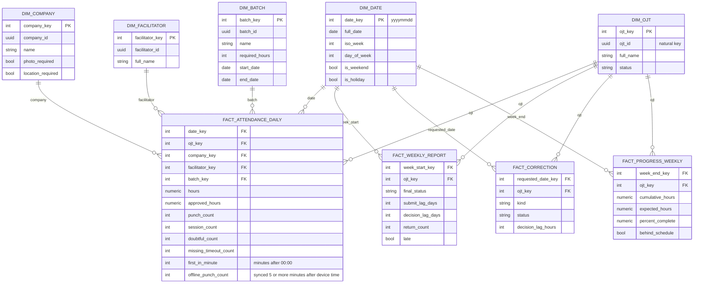
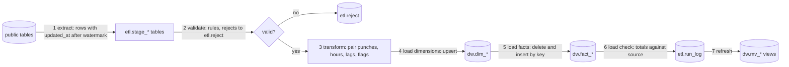

# IT-EL-5 plan: ETL, data warehouse, and analytics dashboard

Status: ACCEPTED (user, 2026-10-26). The decisions in section 3 are recorded in `decision-log.md` as D-53 to D-62. Work is on hold: stage E0 starts only when the user says so. The requirements in section 5 get their final IDs in stage E0.

## 1. Purpose and result

IT-EL-5 adds parts to OJT-DTR. The IT-EL-5 lead grades only these parts. Priority (D-62):

1. An ETL pipeline that reads the operational data and loads the analysis tables. Must.
2. Data analysis and an analytics dashboard that read the analysis tables. Must.
3. A full data warehouse (star schema with dimension tables). Should: the lead does not require it.

The result of this plan:

- Analysis tables in a new schema `dw` in the same Supabase database. The dimension tables come after the ETL and the analysis pass their tests.
- An ETL that is written as SQL functions and runs each night with `pg_cron`. The ETL is incremental, repeatable, and has a load check.
- Data analysis in SQL (trends, correlation, percentiles, completion forecasts) and an analytics dashboard in the existing admin web app (new feature folder `features/analytics`).
- A demo data generator, so that the dashboard shows real patterns, not 9 seed accounts.
- Evidence for the finale proposal, section 8 (ETL, replication, query optimization).

## 2. Recommended option

Recommendation: Option A (warehouse in a separate schema of the same database) with Option D (charts in the admin web app). Options B, C, and E are not recommended.

| Option | Result | Reason |
|---|---|---|
| A: `dw` schema, same database, `pg_cron` | Selected | No new free slot. No secret across projects. ETL in SQL is easy to show and to test. The database stays far below 500 MB. |
| B: separate warehouse project | Not selected | It uses the last free slot, which `ojt-dtr-prod` needs (ENV-01). It adds a second pause risk and a cross-project secret. Isolation is possible in one database with a schema and grants. |
| C: external BI tool (Metabase or similar) | Not selected | It needs free hosting that stays on. It adds a tool to keep alive. The lead must also see ETL and warehouse work, and a BI tool hides the dashboard work. |
| D: admin web charts | Selected (with A) | The admin shell, the login, and the web build exist now. The dashboard does not need the S3 admin pages. |
| E: CSV export and a notebook | Not selected | It gives no warehouse and no dashboard. The lead asked for both. |

## 3. Decisions

All accepted by the user on 2026-10-26. The decision log has the full text. D-62 changes the priorities of section 4 and section 5.

| ID | Decision | Reason |
|---|---|---|
| D-53 | IT-EL-5 is a separate track with its own stages E0 to E3 and its own gates (section 8). The track can start before the S1 gate passes. The SOFTDEV gates do not wait for the track. Each push must keep the SOFTDEV regression suites green (G5). | The S1 gate waits only for operation items (keep-alive source B). The IT-EL-5 parts do not change the SOFTDEV code paths. The SOFTDEV work is about one stage ahead of the timeline. |
| D-54 | New module codes: `ETL` (pipeline), `DW` (warehouse), `ANA` (analytics dashboard). Add them to the module code list in `AGENTS.md` and to `system-modules.md`. | The lead grades three parts. One code for each part gives clear traceability from requirement to test. |
| D-55 | The warehouse is the schema `dw` in the same database (`ojt-dtr-dev` now, `ojt-dtr-prod` later). The Data API does not expose `dw`. Only the ETL functions write to `dw`. The dashboard reads `dw` only through admin-only RPC functions in `public` (prefix `analytics_`). | One write path into `dw`. RLS on `public` stays as it is. The admin check is the same `private.is_admin()` that the tested functions use. |
| D-56 | The ETL is a set of PL/pgSQL functions in schema `etl`. `pg_cron` starts `etl.run()` each night at 01:30 Manila time. An admin can also start a run from the dashboard (`analytics_run_etl`). | `pg_cron` is free on Supabase. SQL is the shortest path from source to warehouse. No secret leaves the database. |
| D-57 | The ETL is incremental with a watermark on `updated_at` (from `private.touch_row()`). Each run deletes and loads again the fact rows of each changed OJT and date. A full rebuild (`etl.rebuild()`) gives the same rows as many incremental runs. | Repeatable output (the draft, section 3.2). Facts derived from punch pairs change when a late punch arrives. A delete and insert by key is simpler than a merge for each measure. |
| D-58 | The warehouse is a derived copy. The weekly backup keeps the `dw` and `etl` schema definitions but not the `dw` rows. After a restore, `etl.rebuild()` makes the rows again. | The backup stays small. The source of truth stays in `public`. This adds no work to BK-01. |
| D-59 | The ETL calculates the hours in SQL (`etl.session_hours()`) with the same pairing rules as `hours.ts` (FR-DTR-06, D-51). A parity test runs the same punch fixtures through both and compares the results. | The server has no hours function today. The hours on the dashboard must agree with the hours in the app. |
| D-60 | The charts use Apache ECharts 5 (`echarts`, Apache-2.0) with tree-shaken imports, only in the admin web build. The mobile build does not import it. Charts obey the `dataviz` skill rules (one palette, light and dark). | Free licence, many chart types (heat map, funnel), no server. Tree shaking keeps the web bundle small. The APK size target (QR-PE-06) does not change. |
| D-61 | Demo data: a generator script (`system/backend/scripts/demo-data.ts`) adds one demo batch with about 60 OJTs, 6 companies, 6 facilitators, and 10 weeks of punches, reports, and corrections. All demo rows use the batch name prefix `DEMO`. A second command removes them. The L2 tests do not use demo rows. The grading can use demo data. | The seed data (9 accounts) is too small for analytics. A fixed prefix lets the tests and the removal find the rows. The lead accepts demo data. |
| D-62 | Priority: ETL and data analysis first. The analysis tables (the fact tables of section 4) are Must. The dimension tables, `dim_date`, and the materialized views are Should, and come after the ETL and the analysis pass their tests. | The lead does not require a warehouse. The ETL needs a target, and the analysis needs tables at a known grain. |

NOTE: The D-56 reason changed: the lead does not specify an ETL tool, so the agent selected the best fit (SQL and `pg_cron`). The statistical analysis also uses the PostgreSQL aggregate functions (`regr_slope`, `corr`, `percentile_cont`).

## 4. Analysis data design

### 4.1 Star schema

NOTE: D-62. Build the four fact tables first, as the analysis tables. Until the dimension tables exist, the fact tables keep the natural keys (`ojt_id`, `company_id`, `facilitator_id`, `batch_id`, and the date) and the analysis functions join to the `public` master tables. The dimension tables and the surrogate keys come later (Should).

### 4.2 Grain and rules

| Table | Grain | Type |
|---|---|---|
| `fact_attendance_daily` | One OJT, one day with one or more punches | Transaction (derived) |
| `fact_weekly_report` | One weekly report | Accumulating snapshot |
| `fact_correction` | One correction request | Accumulating snapshot |
| `fact_progress_weekly` | One OJT, one week of the batch | Periodic snapshot |

1. The dimensions are type 1 (overwrite). The fact rows keep the company, facilitator, and batch keys of the assignment on that day. A reassignment does not change old rows.
2. `dim_date` covers 2026-01-01 to 2027-12-31. The holiday list comes from `ops.settings`.
3. Each fact table has a primary key on its grain. A second load of the same data gives zero new rows (D-57).
4. "Behind schedule" (also used by FR-MON-03): cumulative hours are less than 90% of the expected hours. Expected hours = required hours × days passed ÷ batch days. The 90% value is in `ops.settings`.
5. "Late report": not submitted by the Monday after the week, 23:59 Manila time.
6. Indexes: one B-tree index for each foreign key of each fact table, and one composite index on (`batch_key`, `date_key`).

### 4.3 ETL steps

| Step | Content |
|---|---|
| 1 Extract | Copy the changed rows of `punches`, `weekly_reports`, `report_events`, `correction_requests`, and the master tables to `etl.stage_*`. Each run gets a `run_id`. |
| 2 Validate | Reject rows with a time-out with no time-in on the same day, hours above 16 for one day, or a reference to an unknown master row. Write each reject with its cause code. Rejects do not stop the run. |
| 3 Transform | Pair the punches (D-59). Calculate the lags and flags. Find the affected (OJT, date) keys. |
| 4 and 5 Load | Upsert the dimensions. Delete and insert the fact rows of the affected keys in one transaction. |
| 6 Load check | Compare: number of source punches = sum of `punch_count` + rejected punches; sum of hours from the source = sum of `hours`; number of reports = rows in `fact_weekly_report`. Write the result to `etl.run_log` (status `ok` or `check_failed`). |
| 7 Refresh | Refresh the materialized views that the dashboard reads (`dw.mv_batch_weekly`, `dw.mv_company_summary`). Should (D-62): until the views exist, the dashboard reads the fact tables through the indexes. |

If a step fails, the transaction rolls back, the watermark does not move, and `etl.run_log` gets the status `failed` and the error text.

## 5. New requirements (draft IDs)

The IDs are proposed. They become final when the user accepts D-54.

### 5.1 ETL

| ID | Requirement | Priority |
|---|---|---|
| FR-ETL-01 | The system must load the warehouse each night from the operational tables. | Must |
| FR-ETL-02 | The ETL must load only the rows that changed after the last successful run. A full rebuild must give the same warehouse rows as the incremental runs. | Must |
| FR-ETL-03 | The ETL must check each row against the validation rules and record each rejected row with a cause code. | Must |
| FR-ETL-04 | After each load, the ETL must compare the totals of the warehouse with the totals of the source and record the result. | Must |
| FR-ETL-05 | The ETL must record each run: start time, end time, rows read, rows loaded, rows rejected, and status. | Must |
| FR-ETL-06 | The admin should be able to start an ETL run from the dashboard. | Should |

### 5.2 Warehouse

| ID | Requirement | Priority |
|---|---|---|
| FR-DW-01 | The warehouse should have the dimensions date, OJT, company, facilitator, and batch. | Should (D-62) |
| FR-DW-02 | The warehouse must have the analysis tables of section 4.2 at the grain that section 4.2 gives. | Must |
| FR-DW-03 | Only the ETL must write to the warehouse. The mobile app and the Data API must not write to it. | Must |
| FR-DW-04 | The warehouse hours must agree with the app hours for the same punches (D-59). | Must |
| FR-DW-05 | The warehouse must be possible to rebuild from the operational tables after a restore. | Must |

### 5.3 Data analysis and dashboard

The lead has no fixed list of charts or KPIs. The team selects them (D-60). This list is the team's selection. FR-ANA-10 to FR-ANA-13 are the data analysis items (D-62): they give findings, not only totals.

| ID | Requirement | Priority |
|---|---|---|
| FR-ANA-01 | The web app must show the admin KPI tiles: active OJTs, total hours this week, percent of reports on time, open corrections, OJTs behind schedule. | Must |
| FR-ANA-02 | The web app must show a chart of the hours for each week, for each batch or company. | Must |
| FR-ANA-03 | The web app must show the progress of each OJT against the expected hours, and mark the OJTs behind schedule. | Must |
| FR-ANA-04 | The web app must show the weekly report status for each week (submitted on time, late, approved, returned). | Must |
| FR-ANA-05 | The web app should show a heat map of the first time-in by day of the week and hour. | Should |
| FR-ANA-06 | The web app should show the doubtful-time and offline punch counts for each company. | Should |
| FR-ANA-07 | The admin must be able to filter all charts by batch, company, facilitator, and date range. | Must |
| FR-ANA-08 | The dashboard must show the time of the last successful ETL run and the load check result. | Must |
| FR-ANA-09 | The admin should be able to export the data of each chart as CSV. | Could |
| FR-ANA-10 | The web app must show the trend of the weekly hours for each batch and company (slope with `regr_slope`) and mark a falling trend. | Must |
| FR-ANA-11 | The web app must show a forecast of the completion date of each OJT from the hours rate of the last 4 weeks, and compare it with the batch end date. | Must |
| FR-ANA-12 | The web app should show the distribution of the daily hours and of the report decision time (median and 90th percentile with `percentile_cont`) for each company and facilitator. | Should |
| FR-ANA-13 | The web app should show the correlation (`corr`) between the doubtful-time and offline punch counts and the late reports and returned reports, for each company. | Should |
| FR-ANA-14 | The analysis must be written in a findings section of the IT-EL-5 report (`docs/08-analysis/it-el-5-report.md`): each question, the method, the result on the demo data, and the limits. | Must |

### 5.4 Relation to SOFTDEV requirements

- FR-MON-03 and FR-MON-04 stay SOFTDEV requirements. Their tests stay as they are. The FR-MON-03 dashboard can read the same `analytics_` functions, but it reads the operational tables in S3 (live data, not the nightly copy). Do not merge the two. A merge makes a SOFTDEV test depend on the IT-EL-5 track.
- FR-EXP-03 (CSV for a batch) does not change. FR-ANA-09 is a different export.
- Quality: add QR-PE for the dashboard (each chart loads in 2 s or less for the demo data) and QR-RE for the ETL (a failed run leaves the warehouse in its last good state). The IDs are given when the quality document is updated (task E0-3).

## 6. Test cases (draft)

New test level codes are not necessary. The cases use the existing levels.

| ID | Level | Content |
|---|---|---|
| TC-U-ETL-01 | U | `etl.session_hours()` and `hours.ts` give the same hours for the shared fixtures (D-59). |
| TC-CI-ETL-01 | CI | A first run on the seed and demo data loads all facts. The load check is `ok`. |
| TC-CI-ETL-02 | CI | A second run with no changes loads zero rows. A rebuild gives the same rows (row hash). |
| TC-CI-ETL-03 | CI | A late punch for an old date changes only the facts of that OJT and date. |
| TC-CI-ETL-04 | CI | Invalid rows go to `etl.reject` with the correct cause code. The run still ends `ok`. |
| TC-CI-ETL-05 | CI | A failure in step 5 rolls back. The watermark does not move. `run_log` shows `failed`. |
| TC-CI-DW-01 | CI | An OJT, a facilitator, and the `anon` role cannot read or write `dw` or call `analytics_` functions. The admin can call them. |
| TC-CI-DW-02 | CI | `EXPLAIN ANALYZE` of each dashboard query uses the indexes or the materialized views. Each query takes 200 ms or less on the demo data. |
| TC-CI-ANA-01 | CI | The trend, forecast, percentile, and correlation functions give the expected values for a small fixed data set (values calculated by hand). |
| TC-SI-ANA-01 | SI | The dashboard on the web app shows each chart with data from `dev`. The filters change all charts. |
| TC-ST-ANA-01 | ST | Change source data (add punches, approve a report), run the ETL, and see the change on the dashboard. The totals on the dashboard agree with a direct SQL count. |
| TC-ST-ANA-02 | ST | Measure the dashboard load time (QR-PE target). |
| TC-UAT-ANA-01 | UAT | The IT-EL-5 lead uses the dashboard to answer five questions (for example: "Which company has the most late reports?"). |

The SOFTDEV coverage measure (D-52) adds the new functions and policies to `coverage-map.json`. The 70% target applies to the new items too.

## 7. Changes to documents and code

### 7.1 Documents

| Document | Change |
|---|---|
| `AGENTS.md` (root) | Module codes `ETL`, `DW`, `ANA`. Add the IT-EL-5 track to the project summary. |
| `docs/01-project/project-charter.md` | Second subject IT-EL-5: scope, grader, separate grading. |
| `docs/01-project/timeline.md` | Track E0 to E3 (section 8). |
| `docs/01-project/decision-log.md` | D-53 to D-62 (done 2026-10-26). |
| `docs/01-project/project-charter.md`, section 8 | Risks R-12 to R-16 (section 10). |
| New: `docs/08-analysis/it-el-5-report.md` | The own IT-EL-5 document (question 5). It contains the findings report (FR-ANA-14). Add the folder to `docs/AGENTS.md`. Build it as a separate deliverable for the IT-EL-5 lead. |
| `docs/02-requirements/functional-requirements.md` | New section with FR-ETL, FR-DW, FR-ANA. Module map. |
| `docs/02-requirements/quality-requirements-iso25010.md` | Two new QRs (section 5.4). |
| `docs/03-architecture/system-modules.md` | Modules 12 to 14, dependencies, backend components (`etl` schema, `pg_cron` job, `analytics_` RPCs). |
| `docs/03-architecture/data-model.md` | New section: warehouse star schema (section 4 of this plan). |
| `docs/03-architecture/network-infrastructure.md` | The ETL runs in the database. The dashboard runs in the admin web app. No new host. |
| `docs/05-testing/test-plan.md` | Track gates (section 8). Regression: the ETL suite joins the L2 suite. |
| `docs/05-testing/test-cases.md` | Section 6 test cases. |
| `docs/07-operations/free-tier-operations-runbook.md` | The `pg_cron` job. Section 7: check `etl.run_log` each week. Rebuild: run `etl.rebuild()` after a restore. |
| New: `docs/03-architecture/etl-design.md` | Section 4.3 in detail: rules, cause codes, load checks, failure handling. |
| New: `docs/05-testing/reports/E-track-test-report.md` | The track test report. |
| SOFTDEV finale proposal, sections 6 and 8 | A short reference to the IT-EL-5 report. Architecture with the warehouse. ETL, query optimization (indexes, materialized views, `EXPLAIN ANALYZE` results), and replication: on the Free plan there is no live replica; the warehouse is a nightly derived copy, and the backup is the recovery copy. |

### 7.2 Code

| Location | Change |
|---|---|
| `system/backend/supabase/migrations/` | `dw_schema` (dimensions, facts, indexes, grants), `etl_functions` (stage, validate, transform, load, check, rebuild, run log), `etl_schedule` (`pg_cron` job), `analytics_rpc` (admin-only read functions and materialized views). |
| `system/backend/tests/` | `etl.test.ts`, `dw-access.test.ts`, `dw-performance.test.ts`. Shared hours fixtures. |
| `system/backend/scripts/` | `demo-data.ts` (add and remove the `DEMO` batch). |
| `system/frontend/src/app/features/analytics/` | Dashboard page, KPI tiles, chart components, filter bar, ETL status, analytics service. Lazy route in `shells/admin.routes.ts` only. |
| `system/frontend/src/app/features/dtr/` | No change. The hours fixtures move to a shared JSON file that both test suites read. |
| `.github/workflows/backup.yml` | Exclude the `dw` rows from the data dump (D-58). |

The operational tables do not change. `sync_push` and `sync_pull` do not change.

## 8. Stages of the IT-EL-5 track

The track runs beside SOFTDEV. When the two compete for time, SOFTDEV comes first, because its due date is fixed and the IT-EL-5 date is soft. Target end of the track: 2026-11-21 (planning target only).

| Stage | Dates | Tasks | Gate |
|---|---|---|---|
| E0: Requirements and design | Starts when the user says so (on hold on 2026-10-26) | 1. Done 2026-10-26: the user accepted D-53 to D-62 and answered section 9. 2. Write the requirements and the test cases. 3. Update the documents of section 7.1 and write `etl-design.md`. | Each new "Must" FR maps to a module and a test case. |
| E1: ETL and analysis tables | About 7 days after E0 | 1. Demo data generator. 2. `dw` migration (fact tables with natural keys). 3. Hours function and parity test. 4. ETL functions and run log. 5. `pg_cron` job. 6. L2 tests TC-CI-ETL-*, TC-CI-DW-01. | TC-U-ETL-01 and all TC-CI-ETL and TC-CI-DW-01 tests pass. The SOFTDEV L2 suite still passes. The nightly job ran on `dev` for 3 nights with `ok`. |
| E2: Analysis and dashboard | About 8 days after E1 | 1. `analytics_` functions with the statistical analysis (FR-ANA-10 to FR-ANA-13) and TC-CI-ANA-01. 2. Indexes and TC-CI-DW-02. 3. Dashboard page, charts, filters, ETL status. 4. TC-SI-ANA-01. 5. Findings report (FR-ANA-14). | All E2 "Must" tests pass. Lint zero errors. Web build passes. The APK size does not change by more than 0.5 MB. |
| E2b: Warehouse completion (Should) | Only if time is available | 1. Dimension tables and surrogate keys (FR-DW-01). 2. `dim_date`. 3. Materialized views. 4. Run all E1 and E2 tests again. | The E1 and E2 tests still pass. |
| E3: System test and handover | Before 2026-11-21 (planning target) | 1. TC-ST-ANA-01, TC-ST-ANA-02. 2. Apply the migrations to `ojt-dtr-prod` with the SOFTDEV release. 3. Track test report. 4. IT-EL-5 report and its deliverable. Finale proposal references. 5. TC-UAT-ANA-01 with the lead. | Track report in `docs/05-testing/reports/`. The lead does the UAT. |

When E0 starts, give each stage its dates in `timeline.md`. If S3 is at risk, move E2 tasks 3 and 4 after S3. Cut in this order: E2b, FR-ANA-09, FR-ANA-05, FR-ANA-06.

## 9. Questions for the user

Answers from the user on 2026-10-26.

| # | Question | Answer |
|---|---|---|
| 1 | Does the lead accept a warehouse in the same database (a separate schema), or does he require a separate database? | Yes, same database (D-55). |
| 2 | Does the lead have a fixed list of charts or KPIs? | No. The team selects them (D-60, section 5.3). |
| 3 | Does the lead require a specific ETL tool (for example Pentaho, SSIS, or Python with pandas)? | Not specified. Use the best fit: SQL functions and `pg_cron` (D-56). |
| 4 | Must the warehouse use real data, or is demo data acceptable for the grading? | Demo data is acceptable (D-61). |
| 5 | Must IT-EL-5 have its own documents (a separate report), or only sections in the finale proposal? | Yes, its own document, because IT-EL-5 is a different subject. Source: `docs/08-analysis/it-el-5-report.md` (ETL design, analysis tables, findings, test results). Deliverable name: `OJT-DTR - IT-EL-5 ETL and Data Analysis - Rev <n>`. The SOFTDEV finale proposal only refers to it. |
| 6 | Is the warehouse required? | No. Nice to have. Focus on the ETL and the data analysis (D-62). |

Answers from the plan for the draft questions: draft question 2 (data): punches, reports, and corrections; not audit records. Draft question 4 (start before the S1 gate): yes (D-53). Draft question 5 (schema owners): SOFTDEV owns `public`, `private`, and `ops`; IT-EL-5 owns `dw` and `etl`. Draft question 6 (module codes): new codes (D-54).

## 10. Risks

Accepted with the plan. Add them to the charter risk list in stage E0.

| ID | Risk | Control |
|---|---|---|
| R-12 | The SQL hours and the app hours do not agree. | D-59 parity test on shared fixtures. Run it in CI. |
| R-13 | The IT-EL-5 work takes time from S3 and S4. | SOFTDEV first. Cut list in section 8. |
| R-14 | The nightly `pg_cron` job does not prevent the project pause. When the project is paused, the job does not run. | The keep-alive sources A to C stay the control (QR-RE-06). The dashboard shows the last run time (FR-ANA-08). |
| R-15 | Demo data changes the results of SOFTDEV tests that count rows. | Demo rows have the `DEMO` prefix. The L2 tests filter by the seed IDs. Run the full L2 suite with the demo data loaded in E1. |
| R-16 | The lead does not accept SQL and `pg_cron` as an ETL tool. | Low: the lead does not specify a tool (section 9). The fallback is a Python ETL in a GitHub Actions schedule that calls the same load functions. |

## 11. Sources

- `docs/01-project/it-el-5-scope-draft.md`
- `docs/02-requirements/functional-requirements.md` (FR-MON-03, FR-MON-04, FR-EXP-03, FR-DTR-06)
- `docs/03-architecture/data-model.md`, `system-modules.md`
- `docs/05-testing/test-plan.md` (sections 7 and 8)
- `docs/07-operations/free-tier-operations-runbook.md` (section 1)
- `system/backend/supabase/migrations/` (no server hours function exists; `updated_at` from `private.touch_row()`)
- `PROGRESS.md` (ENV-01, BK-01, KA-01)
